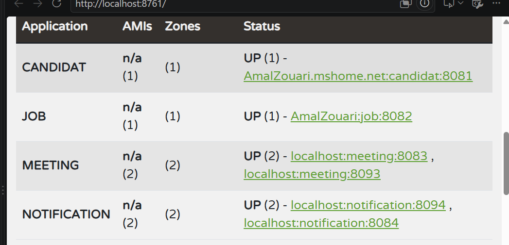

# Atelier Eureka Server – Applications Web Distribuées

Projet microservices avec un serveur de découverte **Eureka (Netflix)**.
Tous les microservices s'enregistrent auprès du même serveur Eureka et se retrouvent grâce à leur nom, au lieu d'une adresse écrite en dur.

Les microservices **Candidat** et **Job** reprennent les entités `Candidate` et `Job` du monolithe Symfony JobBoard : c'est une première étape pour découper le monolithe en microservices.

Toutes les commandes ci-dessous se lancent depuis le dossier `microservices/`.

## Membres de l'équipe

- Amal Zouari
- Somrani Moemen
- Bneabdelaziz Amine
- Trabelsi Amine
- Amari MedAziz 

## Architecture

| Microservice  | Technologie         | Port | Nom dans Eureka | Endpoint hello                  |
|---------------|---------------------|------|-----------------|---------------------------------|
| Eureka Server | Spring Boot         | 8761 | –               | http://localhost:8761 (dashboard) |
| Candidat      | Spring Boot + H2    | 8081 | CANDIDAT        | /api/candidats/hello            |
| Job           | Spring Boot + MySQL | 8082 | JOB             | /api/jobs/hello                 |
| Meeting       | Node.js / Express   | 8083 | MEETING         | /api/meetings/hello             |
| Notification  | Python / FastAPI    | 8084 | NOTIFICATION    | /api/notifications/hello        |
| API Gateway   | Spring Cloud Gateway | 8085 | GATEWAY        | /candidat/hello, /jobs/hello (voir [gateway/README.md](gateway/README.md)) |

Versions : Spring Boot 3.5.6, Spring Cloud 2025.0.0, Java 17.

```
JobBoard_Symfony_6_4/
├── src/, templates/ ...  (monolithe Symfony, inchangé)
└── microservices/
    ├── eureka-server/   (Partie 1)
    ├── candidat/        (Partie 2)
    ├── job/             (Partie 2)
    ├── meeting/         (Partie 3 - Node.js)
    ├── notification/    (Partie 3 - Python)
    ├── gateway/         (Atelier 6 - API Gateway)
    └── docs/            (captures d'écran)
```

## Lancement rapide (Windows)

Démarrer MySQL dans XAMPP, puis depuis le dossier `microservices/` :
```powershell
.\start-all.ps1       # lance Eureka, attend qu'il soit prêt, puis les 6 instances et la Gateway
.\start-all.ps1 -lb   # idem + 2e instance de Candidat (8091) pour observer le load balancing
.\stop-all.ps1    # arrête tout
```

## Lancement manuel (dans cet ordre)

### 1. Eureka Server
```bash
cd eureka-server
mvn spring-boot:run
```
Ouvrir http://localhost:8761 → au début : « No instances available ».

### 2. Candidat et Job
Pour Job, démarrer d'abord **MySQL dans XAMPP** (la base `jobdb` est créée automatiquement).
```bash
cd candidat
mvn spring-boot:run

cd job
mvn spring-boot:run
```

Deuxième instance de Candidat (port 8091) :
```bash
cd candidat
mvn spring-boot:run -Dspring-boot.run.arguments=--server.port=8091
```
Avec IntelliJ : Run → Edit Configurations → Copy Configuration → Modify options → Add VM options : `-Dserver.port=8091`.

### 3. Meeting (Node.js)
```bash
cd meeting
npm install
npm start                 # port 8083
```
Deuxième instance :
- Windows (PowerShell) : `$env:PORT=8093; npm start`
- Windows (cmd) : `set PORT=8093 && npm start`
- Linux / macOS : `PORT=8093 npm start`

### 4. Notification (Python)
```bash
cd notification
pip install -r requirements.txt
python main.py            # port 8084
```
Deuxième instance :
- Windows (PowerShell) : `$env:PORT=8094; python main.py`
- Windows (cmd) : `set PORT=8094 && python main.py`
- Linux / macOS : `PORT=8094 python main.py`

## Vérification

- Dashboard : http://localhost:8761 → CANDIDAT, JOB, MEETING et NOTIFICATION sont visibles en même temps.
- MEETING et NOTIFICATION ont chacun 2 instances (ports différents).
- Les endpoints hello répondent :
  - GET http://localhost:8083/api/meetings/hello
  - GET http://localhost:8084/api/notifications/hello
  - GET http://localhost:8081/api/candidats/hello
  - GET http://localhost:8082/api/jobs/hello

## Comment ça marche (résumé)

- Le serveur Eureka a `register-with-eureka=false` et `fetch-registry=false` : il ne s'inscrit pas lui-même.
- Chaque client envoie ses infos (nom, IP, port) au démarrage, puis un **heartbeat toutes les 30 s**.
- Sans heartbeat pendant **90 s**, l'instance est retirée du registre.
- Node.js utilise `eureka-js-client`, Python utilise `py-eureka-client` (enregistrement dans l'événement `lifespan` de FastAPI, arrêt du client à la fermeture).

## Capture du dashboard Eureka


